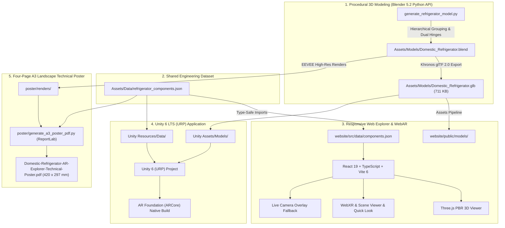

# Domestic Refrigerator AR Explorer

Interactive 3D Visualization and Augmented Reality Engineering Educational Application for a Domestic Household Refrigerator.

**Institution:** COEP Technological University, Pune (Formerly College of Engineering, Pune)  
**Department:** Department of Robotics and AI  
**Academic Year:** 2026–2027  
**Project Guide:** Dr. Shubhangi Deshmukh  

### Prepared by:
- **Sahil Panchavishe** — Enrollment No: `612302040`
- **Megh Shidam** — Enrollment No: `612302058`

---

## 1. Project Overview & Motivation

Students typically encounter the Vapour Compression Refrigeration (VCR) cycle as an idealized four-stage thermodynamic schematic ($1 \rightarrow 2 \rightarrow 3 \rightarrow 4$). However, an actual household refrigerator is a complex thermal appliance with internal cooling loops, concealed capillary lines, polyurethane insulation, and machinery trays.

The **Domestic Refrigerator AR Explorer** connects thermodynamic theory to physical hardware:
1. **Interactive 3D Hardware Anatomy:** Inspect 13 indexed major assemblies with single-part highlights and isolated ghosting views.
2. **Dual-Hinged Door Animation:** Mechanically accurate door opening and closing around vertical hinge pivot axes ($-0.485\,\text{m}$ and $+0.485\,\text{m}$) revealing interior storage, shelves, crisper drawers, and the upper freezer evaporator duct.
3. **Augmented Reality (AR):** Place the life-size refrigerator directly into your room via install-free WebAR (WebXR & Google Scene Viewer on Android, AR Quick Look on iOS), or use the desktop/laptop live camera overlay mode.
4. **Thermodynamic Cycle Simulation:** Trace the high-pressure and low-pressure circuits, heat absorption ($Q_{\text{in}}$), heat rejection ($Q_{\text{out}}$), constant-enthalpy capillary throttling ($h_3 = h_4$), and coefficient of performance ($\text{COP} = Q_{\text{in}} / W_{\text{in}}$).
5. **Print-Ready Four-Page A3 Landscape Poster:** A print-quality technical poster inspired by classical ANSI/ISO engineering drawings.

---

## 2. System Architecture



---

## 3. Verified 3D Model Specifications

- **Asset Path:** `Assets/Models/Domestic_Refrigerator.glb` & `website/public/models/Domestic_Refrigerator.glb`
- **Format:** glTF 2.0 Binary (`.glb`)
- **Validation:** 0 errors, 0 warnings (Khronos glTF-Validator 2.0)
- **Hierarchy:** 165 named nodes, 151 meshes, 15 PBR materials
- **Scale:** $1.00\,\text{m}$ width $\times$ $0.72\,\text{m}$ depth $\times$ $1.80\,\text{m}$ height (typical standard French door / side-by-side domestic scale)
- **Animated Door Hinges:**
  - `10_Fresh_Food_Door_Assembly`: Pivot axis at $(-0.485, 0.355, 0.0)$, smooth rotation $0^\circ \rightarrow +78^\circ$.
  - `11_Freezer_Door_Assembly`: Pivot axis at $(+0.485, 0.355, 0.0)$, smooth rotation $0^\circ \rightarrow -78^\circ$.

---

## 4. Components & Educational Catalog

| Part # | Assembly Node | Name | Cycle Role |
| :---: | :--- | :--- | :--- |
| **01** | `01_Compressor` | Hermetic Compressor | Work Input ($W_{\text{in}}$), low-pressure vapour to hot gas |
| **02** | `02_Condenser_Coil` | Condenser Coil & Brackets | High-side heat rejection ($Q_{\text{out}}$) to room ambient |
| **03** | `03_Capillary_Tube` | Capillary Tube (Throttling) | Isenthalpic pressure drop ($h_3 = h_4$) |
| **04** | `04_Evaporator_Unit` | Evaporator Coil & Cooling Fins | Low-side heat absorption ($Q_{\text{in}}$) from food cavity |
| **05** | `05_Filter_Drier` | Liquid-Line Filter-Drier | Molecular sieve zeolite moisture & particulate removal |
| **06** | `06_Condenser_Fan` | Condenser Cooling Fan | Forced-convection heat transfer enhancement |
| **07** | `07_Refrigerant_Lines` | Discharge, Return & Suction Lines | Closed-circuit pressure boundary containment |
| **08** | `08_Cabinet_Body` | Cabinet & PUF Insulation | Rigid steel shell & cyclopentane foam ($k \approx 0.02\,\text{W/m}\cdot\text{K}$) |
| **09** | `09_Shelves_And_Drawers` | Shelves, Crispers & Bins | Air distribution & food storage management |
| **10** | `10_Fresh_Food_Door_Assembly` | Fresh Food Door (Hinged) | Magnetic gasket seal, door bins, left hinge pivot |
| **11** | `11_Freezer_Door_Assembly` | Freezer Door (Hinged) | Deep-freeze thermal seal, right hinge pivot |
| **12** | `12_Rear_Ventilation_Grille` | Rear Panel & Ventilation Louvers | Hot air exhaust & electrical/tubing protection |
| **13** | `13_Thermostat_Electrical` | Thermostat & Electrical Wiring | Temperature setpoint sensing & motor cycle control |

---

## 5. Web Application Quickstart

The web application is built with React 19, TypeScript, Vite 6, and Three.js.

### Prerequisites
- Node.js (v18+ or v20+ recommended)
- npm or yarn

### Local Development
```bash
cd website
npm install
npm run dev
```
Open [http://localhost:3000](http://localhost:3000) in your browser.

### Production Build
```bash
cd website
npm run build
```
The static bundle is built into `website/dist/` ready for static deployment on GitHub Pages or any modern web host.

---

## 6. Unity Project Integration

The repository includes a Unity 6 LTS (6000.0.81f1) project structure with Universal Render Pipeline (URP):
- `Assets/Scenes/`: MainMenu, RefrigeratorExplorer, ARExperience.
- `Assets/Scripts/`:
  - `Data/ComponentData.cs` & `ComponentDatabase.cs`: JSON database deserialization.
  - `Core/RefrigeratorController.cs`: Dual hinge door animation, explode view interpolation, isolate ghosting.
  - `Core/OrbitCameraController.cs`: Touch and mouse orbit, pan, pinch zoom, preset views.
  - `Interaction/ComponentSelector.cs`: Raycast selection ignoring UI overlays.
  - `UI/UIController.cs`: Component information cards, navigation, view presets.
  - `AR/ARController.cs`: AR Foundation camera management with graceful permission handling.
- `Assets/Models/Domestic_Refrigerator.glb`: Primary 3D asset.
- `Packages/manifest.json`: Pre-configured for URP, Input System, AR Foundation, and ARCore.

---

## 7. Four-Page A3 Landscape Technical Poster

A print-ready 4-page A3 landscape PDF ($420 \times 297\,\text{mm}$) is generated via ReportLab and Python:
- **Sheet 1:** Hardware Overview, isometric front open view, rear machinery exploded view, component legend, verified model data.
- **Sheet 2:** Refrigeration Cycle, cycle schematic, $p\text{--}h$ diagram, process breakdown (1–4), high vs low pressure zones, energy balance.
- **Sheet 3:** Project Architecture, implementation flowchart, feature breakdowns, application screenshots.
- **Sheet 4:** Access & Credits, high-error-correction QR codes for AR and Web, instructions, student names, and references.

### Regenerating the Poster
```bash
python3 poster/generate_a3_poster_pdf.py
```
Output is generated at `poster/output/Domestic-Refrigerator-AR-Explorer-Technical-Poster.pdf`.

---

## 8. Academic References & Credits

1. **C. P. Arora**, *Refrigeration and Air Conditioning*, 3rd ed., Tata McGraw-Hill, 2008.
2. **W. F. Stoecker and J. W. Jones**, *Refrigeration and Air Conditioning*, 2nd ed., McGraw-Hill, 1982.
3. **Y. A. Çengel and M. A. Boles**, *Thermodynamics: An Engineering Approach*, 9th ed., McGraw-Hill, 2019.
4. **ASHRAE Handbook**, *Refrigeration: Systems and Practices*, American Society of Heating, Refrigerating and Air-Conditioning Engineers, 2022.
5. **Software & Libraries:** Three.js, Google `<model-viewer>`, React, Vite, ReportLab, Blender Python API, Unity 6 (URP, AR Foundation).
